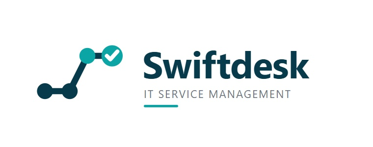

<p align="center">
  
</p>

# Swiftdesk

Swiftdesk is an IT help desk that thinks for itself. Employees report a problem in plain English; the system works out what kind of problem it is, decides how urgent it is (and shows its reasoning), picks the right technician, watches the clock, and escalates if things slip.

Built as a course project for **CS F213 (Object-Oriented Programming)**, set in a made-up fintech company, **Nimbus FinServe Inc.**

**Stack:** Java 21, Spring Boot 3.3, plain HTML/CSS/JavaScript front end (no Node.js needed).

---

## Contents

1. [Installation and Quick Start](#1-installation-and-quick-start)
2. [What it does](#2-what-it-does)
3. [Demo accounts](#3-demo-accounts)
4. [A guided walkthrough](#4-a-guided-walkthrough)
5. [Email and notifications ](#5-email-and-notifications)
6. [Running with a real database](#6-running-with-a-real-database)
7. [Tests](#7-tests)
8. [Built-in demo scenarios](#8-built-in-demo-scenarios)
9. [How the code is organised](#9-how-the-code-is-organised)
10. [Intelligent Features](#10-intelligent-features)
11. [Course concepts](#11-course-concepts)
12. [Documentation](#12-documentation)

---

## 1. Installation and Quick Start

**You need:** JDK 21. Nothing else (the Maven wrapper is included).

```powershell
# Windows
.\mvnw.cmd spring-boot:run
```

```bash
# Linux / macOS
./mvnw spring-boot:run
```

Then open **http://localhost:8085/**.

The app starts with an in-memory database and fills it with a demo company, so there is nothing to set up. Everything resets when you stop it.

| Link | What it is |
|---|---|
| http://localhost:8085/ | The web app |
| http://localhost:8085/swagger-ui.html | Interactive API docs |
| http://localhost:8085/actuator/health | Health check |

> If Windows can't find Java, point `JAVA_HOME` at your JDK 21 first, for example
> `$env:JAVA_HOME = "C:\Program Files\Microsoft\jdk-21.0.12.101-hotspot"`

---

## 2. What it does

| Step | What happens |
|---|---|
| **Report** | An employee describes a problem in their own words. |
| **Understand** | The system reads the text and guesses the category (network, database, security, ...). If it isn't confident, a human decides instead. |
| **Prioritise** | A priority from P1 (critical) to P4 (minor) is calculated from several factors, and the breakdown is kept so it can be explained. |
| **Assign** | The ticket goes to the right team and a technician with free capacity. Administrators can see why that technician was chosen. |
| **Track** | Each ticket has an SLA clock (response and resolution deadlines). The clock pauses while waiting for the employee. |
| **Escalate** | Late tickets move up: technician, then team lead, then admin, then IT manager. |
| **Close** | The employee confirms the fix and rates it. |

### Protection and fairness

- **Sign-in safety.** Five wrong passwords lock the account. The error never says whether the email or the password was wrong. Administrators can turn on two-step verification.
- **Different people see different things.** Employees never see priority, SLA details or internal notes. This is enforced by the data the server sends, not just by hiding things on screen.
- **Paused clock.** While the technician waits for the employee's answer, the SLA timer stops, so the technician isn't blamed.
- **Humans stay in charge.** Unsure or wrong-team tickets go to an admin triage queue rather than being guessed.
- **Everything is recorded.** Every step is written to an audit trail (time, user, action, old and new state) and sends notifications: bell icon (live), email and simulated SMS.
- **A simulation clock** (+15m / +1h / +24h in the top bar) lets you fast-forward hours of SLA time in a click, so demos don't need waiting.

### What each screen does

| Tab | Who uses it | What you can do |
|---|---|---|
| **Employee** | Anyone | **Report an Issue** (type it, or click a ready-made example). **My Active Tickets** with a progress bar: answer questions, then **Verify & Close** (1 to 5 stars) or **Reject fix**. **History** of closed tickets. |
| **Technician** | Support staff | A workload meter (for example 3 / 7 tickets) and your queue. Buttons: Acknowledge, Start Investigation, Add Note, Request Info (pauses the timer), Resolve, Flag Out-of-Scope, Suggested fixes, Promote to knowledge base. |
| **Team Lead** | Team leads | Each member's workload, tickets nobody has taken, and tickets close to their deadline. Assign or Reassign a ticket, or Inspect Escalation to jump to it. |
| **Admin** | Administrators | **Incident Catalog**: filter every ticket by status, priority, category, service, technician, date or ID; click one for full details (SLA, priority breakdown, why this technician, notes, audit trail), then Override Priority, Reassign or Close. **Triage Queue**: fix the category and reassign, or reject a technician's flag. **Routing Strategies**: choose how technicians are picked; it changes immediately. |
| **Simulation** | Administrators | Control the virtual clock, run scenarios S1 to S5 with a live log, compare assignment methods. |
| **Reports** | Administrators | Average response and resolve time, SLA success rate, team workload, tickets per service, SLA results per priority, escalation history. |

### SLA targets

Every ticket gets two timers when it is created: a **response** target (how soon a technician must accept it) and a **resolution** target (how soon it must be solved).

| Priority | Typical services | Response within | Resolve within |
|---|---|---|---|
| **P1** Critical | Payment gateway, core banking database, single sign-on | 5 min | 30 min |
| **P2** High | VPN, CRM, email, data warehouse | 15 min | 2 hours |
| **P3** Medium | Office Wi-Fi, CI/CD pipeline, HR portal | 1 hour | 8 hours |
| **P4** Low | Printing, laptops, wiki, general help | 4 hours | 24 hours |

Status is based on how much of the resolution time is used: **On Track** (under 75%), **At Risk** (75%+, technician reminded), **Warning** (90%+, team lead alerted), **Breached** (missed, recorded and escalated) and **Met** (solved in time). Missing the response deadline counts as a breach even if the fix is on time. Admins can change the policies.

### When something goes wrong

| Situation | What the system does |
|---|---|
| Category confidence under 60% | Not auto-assigned; goes to the admin triage queue |
| Ticket sent to the wrong team | Technician flags it; it returns to triage, the slot is freed, an admin reassigns |
| Same problem reported again | Linked as a duplicate, no technician slot used |
| Technician busy, away or full | Skipped. If nobody is free the ticket waits and is retried in the background |
| Two people edit one ticket at once | First save wins; the second sees a "conflict, try again" message |
| Illegal step (for example closing a new ticket) | Refused, the ticket stays as it was |
| Wrong input or a forbidden action | Refused with a message naming the problem |
| Email or SMS is down | Logged; other channels still deliver and the ticket is unaffected |

---

## 3. Demo accounts

Every demo account uses the password **`Password123!`**

| Role | Email |
|---|---|
| Employee | `employee@nimbusfinserve.com` |
| Technician (Network) | `tech.network@nimbusfinserve.com` |
| Team lead (Network) | `lead.network@nimbusfinserve.com` |
| IT manager | `manager@nimbusfinserve.com` |
| Administrator | `admin@nimbusfinserve.com` |

The table above lists only a few accounts, just enough for a quick demo. We have created many more demo accounts, and they all use the same password. The demo company has 6 support teams (Network, Database & Storage, Application, Security, Cloud Platform, Service Desk), each with a team lead and 3 technicians. Every technician and team lead has their own login, and signing in with it takes you straight to that person's own technician console, for their own field. For example, `tech.sec1@nimbusfinserve.com` opens Carlos Mendez's console in the Security team. More technician logins follow the same pattern, such as `tech.net2@`, `tech.db1@`, `tech.desk1@` and `lead.sec@`.

---

## 4. A guided walkthrough

Follow one ticket from start to finish by signing in as three different people. Sign out between steps.

**1. As the employee** (`employee@nimbusfinserve.com`)
- Notice you only see the Employee tab.
- Report a problem, for example: *"VPN tunnel drops during institutional block trade"*.
- The system files it under Network and assigns a technician.

**2. As the technician** (`tech.network@nimbusfinserve.com`)
- Open the ticket and click **Acknowledge**, then **Start Investigation**.
- Add a note, then **Resolve** with a root cause and the steps you took.

**3. As the employee again**
- The tracker now shows **Resolved**.
- Click **Confirm Fixed** and leave a rating. The ticket closes.

**4. As the administrator** (`admin@nimbusfinserve.com`)
- Open the ticket in the Admin tab to see the priority breakdown, the audit trail, and why that technician was picked.

---

## 5. Email and notifications (optional)

The app sends notifications three ways: an in-app bell, simulated SMS (printed in the console), and email.

**You do not need to set any of this up.** With no mail server, the app keeps working: the bell and console messages still arrive, and the email attempt is logged as a warning and skipped.

If you want to see the emails, pick one:

<details>
<summary><b>Local inbox with Mailpit (easiest, needs Docker)</b></summary>

```bash
docker compose up mailpit -d
```

Open http://localhost:8025/ to read every email the app sends. No accounts or passwords needed.
</details>

<details>
<summary><b>Send to your own Gmail</b></summary>

The demo addresses (`@nimbusfinserve.com`) aren't real, so Gmail would reject mail sent to them. The `REAL_EMAIL_OVERRIDE` setting sends every notification to *your* inbox instead, with the intended recipient shown in the subject line.

1. In your Google Account, create an **App Password** (Security, then 2-Step Verification, then App passwords).
2. Set these variables and start the app:

```powershell
$env:SPRING_MAIL_HOST = "smtp.gmail.com"
$env:SPRING_MAIL_PORT = "587"
$env:SPRING_MAIL_USERNAME = "your-email@gmail.com"
$env:SPRING_MAIL_PASSWORD = "your-16-char-app-password"
$env:SPRING_MAIL_PROPERTIES_MAIL_SMTP_AUTH = "true"
$env:SPRING_MAIL_PROPERTIES_MAIL_SMTP_STARTTLS_ENABLE = "true"
$env:REAL_EMAIL_OVERRIDE = "your-email@gmail.com"

.\mvnw.cmd spring-boot:run
```

Now every logged, assigned, escalated or resolved ticket sends a real email to your inbox.
</details>

---

## 6. Running with a real database

The default mode is in-memory. To use PostgreSQL and Mailpit through Docker:

```bash
docker compose up -d
./mvnw spring-boot:run -Dspring-boot.run.profiles=prod
```

| Service | Address |
|---|---|
| Web app | http://localhost:8085/ |
| PostgreSQL | `localhost:5432`, database `iitsm_prod` |
| Mailpit inbox | http://localhost:8025/ |

The `prod` profile is stricter than the demo mode. For example, Swagger is switched off and sign-ups are limited to the company email domain. See [docs/security-considerations.md](docs/security-considerations.md) for the settings.

---

## 7. Tests

```bash
./mvnw clean verify          # everything (Windows: .\mvnw.cmd clean verify)
./mvnw test -Pfast           # quicker: skips the slow database and benchmark tests
```

Last full run: **2,057 tests, 0 failures, about 93% line coverage.** The build fails if coverage drops below 70%.

Architecture rules are tested too. For instance, one test fails the build if the core business code ever imports Spring.

---

## 8. Built-in demo scenarios

Five scripted scenarios can be run from the **Simulation** tab (as administrator) or the API. They use the simulation clock, so they finish in moments.

| ID | Scenario | What you see |
|---|---|---|
| S1 | Happy path | Report, acknowledge, investigate, resolve, verify, close |
| S2 | Critical outage | A P1 ticket gets late and escalates up the chain |
| S3 | Wrong team | A technician says "not my area"; an admin re-routes it |
| S4 | Duplicate storm | Five reports of one outage are linked together |
| S5 | Waiting on the user | The SLA clock pauses while info is requested, then resumes |

<details>
<summary><b>Run them from the command line</b></summary>

```bash
TOKEN=$(curl -s -X POST http://localhost:8085/api/auth/login \
  -H "Content-Type: application/json" \
  -d '{"email":"admin@nimbusfinserve.com","password":"Password123!"}' | jq -r .token)

curl -X POST http://localhost:8085/api/simulation/run/S1 -H "Authorization: Bearer $TOKEN"
```

Replace `S1` with `S2` to `S5` for the others.
</details>

---

## 9. How the code is organised

The code is split into layers that only depend inward, so the business rules stay free of framework details:

```
web  →  application  →  domain  ←  infrastructure
```

| Layer | Contains |
|---|---|
| `domain` | The core rules: tickets, the lifecycle state machine, priority, assignment, SLA, escalation. Plain Java, no Spring. |
| `application` | Services that coordinate a use case in one transaction. |
| `infrastructure` | Database, security, email, schedulers. |
| `web` | REST controllers and the role-specific response objects. |

The main object-oriented ideas on show, with a place to find each:

| Idea | Where |
|---|---|
| **State**: a ticket's behaviour depends on its status | `domain/state` |
| **Strategy**: swappable assignment, classification, priority, similarity | `domain/strategy` |
| **Chain of Responsibility**: the four escalation tiers | `domain/chain/escalation` |
| **Observer**: events trigger audit records and notifications | `domain/event`, `infrastructure/observer` |
| **Decorator**: the adjustable simulation clock | `infrastructure/config/AdjustableClock` |
| **Factory**: creating users and tickets safely | `application/service` |
| **Repository**: domain interfaces, with database adapters elsewhere | `domain/repository`, `infrastructure/persistence` |

The text classifier is written in plain Java too (TF-IDF, cosine similarity, Naive Bayes), so there is no heavy machine-learning library and its decisions can be explained.

---

## 10. Intelligent Features

**Priority levels.** There are four levels: **P1 – Critical** (most urgent), **P2 – High**, **P3 – Medium** and **P4 – Low** (least urgent). P1 gets the shortest deadlines. The level comes from a score between 0 and 1 made from six factors, each with a weight (how much it counts): importance of the affected service 30%, impact 20%, urgency 15%, the reporter's designation 15%, how long the ticket has waited 10% and the reporter's past history 10%. A score of 0.75 or more is P1, 0.55 or more is P2, 0.35 or more is P3, and less is P4. Some rules can raise it: a mission-critical service going down is always P1, a confirmed security breach is at least P2, and five or more duplicate tickets raise the level by one.

These features from the problem statement are all working:

1. **Intelligent Priority Determination**: the weighted score and rules above. The admin can override it.
2. **Incident Categorization**: the system reads the title and description and picks the category (Network, Database, Security and so on) and the affected service. If it is less than 60% sure, a human decides.
3. **Duplicate Incident Detection**: a new ticket is compared with tickets from the last 72 hours. If the text is at least 70% similar, it is marked as a duplicate.
4. **Incident Correlation**: duplicates are linked to one main ticket and do not use extra technician time.
5. **Smart Technician Recommendation**: the best technician is picked using skills, current workload, experience and past work on the same service. The admin can see "Why this technician".
6. **SLA Risk Detection**: the system keeps checking how much of the time limit is used and marks tickets At Risk, Warning or Breached (see Section 5).
7. **Automatic Escalation**: if deadlines are missed, alerts go up step by step: Technician → Team Lead → System Admin → IT Manager.
8. **Suggested Resolution**: the system shows up to three similar past fixes for a ticket.

**Extra smart features beyond the list:**

- *Wrong-password protection*: after 5 wrong password tries the account is locked automatically. The error message does not reveal whether the email or the password was wrong, and only an admin can unlock the account.
- *Human triage queue*: unsure or wrong-team tickets go to an admin instead of being guessed.
- *Explainable decisions*: every priority and technician choice shows its reasons.
- *Strategy comparison*: a simulator that compares assignment methods (solving time, missed deadlines, fairness).
- *Knowledge base with votes*: technicians save good fixes and votes help rank them.
- *Live notifications*: the bell updates by itself; email and a simulated SMS are also sent.
- *Timer pausing*: time spent waiting for the employee does not count against the technician.

---

## 11. Course concepts at a glance

Where each CS F213 topic shows up in the code.

| Course concept | Where to see it |
|---|---|
| **Encapsulation, immutability** | `Incident` keeps private fields and changes only through methods like `acknowledge()` and `resolve()`. Value objects such as `Priority` and `Email` are Java records. |
| **Abstraction, interfaces** | `AssignmentStrategy`, `IncidentClassifier`, `NotificationChannel`, `IncidentRepository`. Callers depend on the interface, not the class. |
| **Inheritance (true is-a only)** | Abstract `User`, then `Employee`, `Technician`, `Administrator`; `TeamLead` extends `Technician`. All custom errors extend `IitsmException`. |
| **Polymorphism, overriding, dynamic dispatch** | The 9 ticket-state classes, 5 assignment strategies and 3 notification channels are swapped through one interface each. The admin can change the strategy while the app runs. |
| **Composition, association** | An `Incident` owns its SLA tracker, priority decision and notes. The composite classifier is built from two classifiers. |
| **Packages, access control** | Layered packages (`web`, `application`, `domain`, `infrastructure`). The domain package has no Spring imports, and an ArchUnit test fails the build if that changes. |
| **Exception handling** | Custom unchecked exceptions such as `InvalidStateTransitionException` and `TechnicianOverloadedException`, turned into clear messages by one global handler. |
| **Collections** | `EnumMap` for state lookup, `PriorityQueue` for the unassigned queue, `Deque`, `ConcurrentHashMap`, `Comparator`, and unmodifiable getters. |
| **Generics, lambdas, streams** | Used throughout the application layer, with `Optional` instead of nulls. |
| **Strings and regex** | Text normalisation for the classifier and removal of personal data from saved fixes. |
| **File I/O** | The classifier is trained at start-up from a CSV file. |
| **Multithreading and synchronisation** | Scheduled SLA scans, a dispatcher job, a notification worker thread, and locks that keep ticket intake safe under load. |
| **Design patterns** | State, Strategy, Observer, Chain of Responsibility, Factory, Repository, Adapter, Composite and Decorator. Classes carry a `Pattern:` or `OOP:` note in their Javadoc. |
| **OO analysis and design** | Requirements, use case and class diagrams (`docs/uml/`), and written design decisions (`docs/DECISIONS.md`). |

---

## 12. Documentation

Start with **[docs/03-architecture.md](docs/03-architecture.md)** for the big picture.

| Topic | File |
|---|---|
| Problem and stakeholders | [docs/01-problem-analysis.md](docs/01-problem-analysis.md) |
| Requirements | [docs/02-requirements.md](docs/02-requirements.md) |
| Architecture | [docs/03-architecture.md](docs/03-architecture.md) |
| Technology choices | [docs/04-technology-report.md](docs/04-technology-report.md) |
| Design patterns (viva guide) | [docs/05-design-patterns.md](docs/05-design-patterns.md) |
| Security | [docs/security-considerations.md](docs/security-considerations.md) |
| Design decisions (ADRs) | [docs/DECISIONS.md](docs/DECISIONS.md) |
| Test cases | [docs/testing/test-cases.md](docs/testing/test-cases.md) |
| Database schema | [docs/db/schema.md](docs/db/schema.md) |
| Diagrams | [docs/uml/](docs/uml/) |

Contributors and AI assistants: the detailed engineering rules live in [CLAUDE.md](CLAUDE.md).
